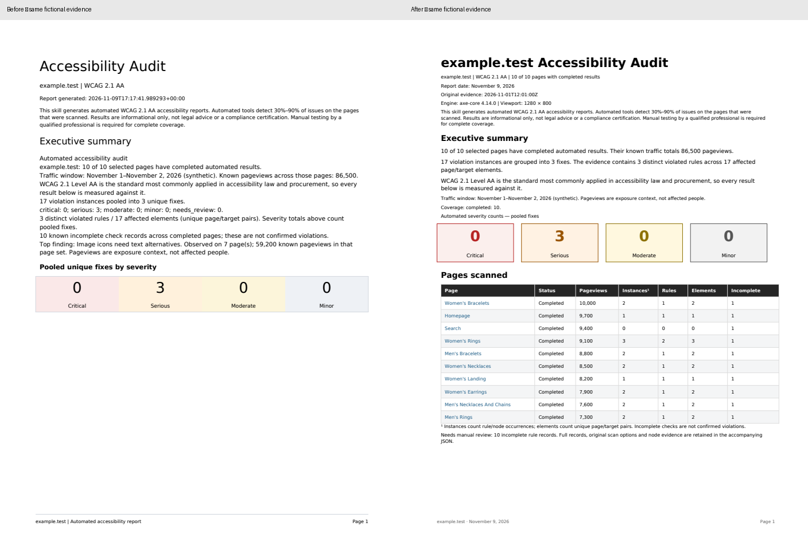

# Accessibility PDF presentation

The report uses a compact executive overview followed by prioritized findings,
matching the supplied report reference's visual hierarchy. It does not change
the scanner, evidence, severity, verified pooling or traffic-based ranking.



- [Before PDF](before.pdf)
- [After PDF](after.pdf)

These samples use **fictional** `example.test` evidence generated by
`example()` in `tests/test_accessibility_pdf.py`: 10 pages, 17 node instances,
3 verified synthetic shared fixes and 10 incomplete rule records. No customer
URLs, traffic, HTML or findings are included. Dates describe synthetic evidence,
not real scans. The supplied Claude report is a visual reference, not test data.

The default PDF has a domain/scope/date heading, applicable verbatim disclaimer,
short executive summary, four labeled severity cards, a linked page table and
numbered findings with criteria, selectors, escaped examples, required changes
and verification. Friendly page names are derived from URLs. Source evidence
dates are separate from the generation date. Full scanner data stays in JSON;
`--technical-appendix` adds scan metadata and incomplete-rule references.

```sh
python skills/accessibility-audit/scripts/build_deliverables.py findings.json \
  --annotations annotations.json --output-dir audit --pdf

python -m unittest discover -s tests -v
```

PDF tests require ReportLab and pypdf. Rendering remains optional when those
dependencies are unavailable. Inspect every rendered page before delivering a
report; automated text/count checks do not prove visual layout or PDF/UA tagging.

The imported multi-state PDF route additionally requires the importer from the
recovery/import PR. Without it, normal scans and limited reviews still work, and
imported bundles report the missing prerequisite. After both changes are present,
the shared layout preserves original timestamps/options and uses explicitly
unpooled rule/scan severity totals. It never claims those are verified pooled fixes
or promotes imported manual notes into automated findings. Imported remediation
boards remain unavailable until component pooling has been verified separately.
